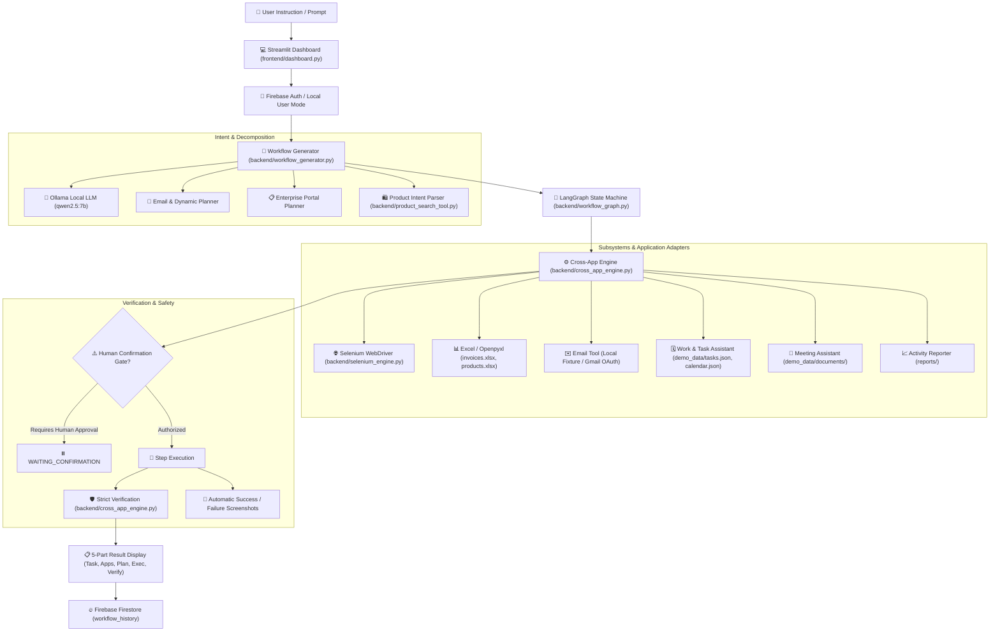

# WorkPilot — Autonomous AI Employee & Cross-Application Automation System

[](https://www.python.org/)
[](https://streamlit.io/)
[](https://www.selenium.dev/)
[](https://github.com/langchain-ai/langgraph)
[-orange.svg)](https://ollama.com/)
[](https://firebase.google.com/)
[](./tests)

**WorkPilot** is an autonomous, private, enterprise-grade AI work assistant and browser automation system. It bridges natural-language business instructions into multi-step cross-application execution across **Web Browsers (Selenium)**, **Spreadsheets (Excel)**, **Invoices**, **Email (Local & Gmail OAuth)**, **Task Boards**, **Calendar Schedules**, and **Executive Documents**.

Every executed workflow features strict outcome verification, automatic screenshot capture on success/failure, human-in-the-loop safety gates for sensitive actions, and persistent audit logging in **Firebase Firestore**.

---

## 📑 Table of Contents

- [System Architecture](#-system-architecture)
- [Key Capabilities](#-key-capabilities)
- [Enterprise Demonstrations (5 Major Demos)](#-five-major-enterprise-demonstrations)
- [Product Search & Automated Excel Reporting](#-product-search--automated-excel-reporting)
- [Technology Stack](#-technology-stack)
- [Project Directory Structure](#-project-directory-structure)
- [Installation & Quickstart](#-installation--quickstart)
- [Configuration & Environment Variables](#-configuration--environment-variables)
- [Testing & Quality Assurance](#-testing--quality-assurance)
- [Human Confirmation & Verification Engine](#-human-confirmation--verification-engine)

---

## 🏗️ System Architecture



---

## 🌟 Key Capabilities

1. **Autonomous Natural Language Understanding**:
   - Converts natural language queries (e.g., *"Process all unpaid invoices"*, *"Find 10 laptops under ₹60,000"*, *"Prepare for my 3 PM client meeting"*) into structured, type-safe Pydantic workflows.
   - 100% private local reasoning via **Ollama** (`qwen2.5:7b`) with deterministic rule-based template fallbacks.

2. **Cross-Application Orchestration**:
   - Integrates disjoint workplace applications: Excel sheets, browser web pages, local file archives, task boards, and email systems with shared in-memory context.

3. **Multi-Site E-Commerce Scraping & Excel Generation**:
   - Live browser automation with Selenium across shopping platforms (Amazon.in, Flipkart).
   - Automatic Excel report generation (`.xlsx`) with custom styling, clickable hyperlinks, and budget filters.

4. **Interactive Employee Work Portal**:
   - Unified offline demonstration portal (`employee_portal/index.html`) featuring interactive Dashboard metrics, Task Board, Calendar, Procurement catalog, Invoice management, and Email client.

5. **Human-in-the-Loop Safety Gate**:
   - High-impact or sensitive operations (financial purchasing, external email dispatch) automatically pause in `WAITING_CONFIRMATION` until explicitly authorized.

6. **Strict Verification & Evidence**:
   - Every action is independently audited (e.g., verifying invoice status in storage, checking outbox records, validating file sizes, verifying cart items). Never claims delivery without proof.

---

## 🚀 Five Major Enterprise Demonstrations

Accessible via 1-click preset buttons on the **Streamlit Dashboard**:

| Demo | Action Button | Canonical Prompt | Cross-Application Flow | Deliverable Output |
| :--- | :--- | :--- | :--- | :--- |
| **Demo 1** | **`💼 Daily Work`** | `"Handle my work for today."` | `Calendar` → `Task Board` → `Emails` → `Documents` → `Daily Executive Summary` → `Verify` | Advances pending tasks, summarizes meetings, writes `reports/daily_work_summary.md`. |
| **Demo 2** | **`📑 Invoices`** | `"Process all unpaid invoices."` | `Excel (invoices.xlsx)` → `Find Unpaid` → `Extract Documents` → `Generate Reminders` → `Send Email` → `Update Excel` → `Verify` | Drafts reminder emails, attaches invoices, marks Excel records as `"Reminder Sent"`, audits outbox. |
| **Demo 3** | **`🛒 Procurement`** | `"Order the office supplies in this spreadsheet."` | `Excel (products.xlsx)` → `Portal Procurement` → `Search Catalog` → `Add to Cart` → `Human Confirmation` → `Download Invoice` → `Verify` | Automates shopping cart via Selenium, enforces human confirmation gate before checkout, downloads procurement invoice. |
| **Demo 4** | **`📅 Meeting Brief`** | `"Prepare for my 3 PM client meeting."` | `Calendar` → `Identify Client (Acrom Systems)` → `Search Emails` → `Project Docs` → `Compile Brief` → `Verify` | Synthesizes agenda, contracts, milestone specs into `reports/meeting_brief_3pm.md`. |
| **Demo 5** | **`📊 Activity Report`** | `"Prepare this month's employee activity report."` | `Task Board` + `Calendar` + `Sent Emails` + `Invoices Excel` → `Aggregate Metrics` → `Compile Report` → `Email Management` → `Verify` | Computes KPIs & completion rates, compiles `reports/employee_activity_report.md`, dispatches email. |

---

## 🛍️ Product Search & Automated Excel Reporting

WorkPilot includes a dedicated natural language shopping scraper and report generator ([backend/product_search_tool.py](file:///c:/Users/neham/OneDrive/Desktop/ROSPL/backend/product_search_tool.py)):

- **Preset Buttons on Dashboard**:
  - `💻 Laptops < ₹60k` → `"Search for laptops under ₹60,000"`
  - `📱 10 Phones < ₹30k` → `"Find 10 smartphones under ₹30,000"`
  - `⚖️ Compare iPhone 16` → `"Compare iPhone 16 prices"`
- **Multi-Site Scraper**:
  - Concurrently queries Amazon.in and Flipkart using headless/live Chrome.
  - Extracts title, price, original price, discount, star rating, and direct product URL.
  - Eliminates duplicate entries and enforces budget constraints.
- **Excel Report Generator (`openpyxl`)**:
  - Outputs a structured spreadsheet: `reports/product_search_YYYYMMDD_HHMMSS.xlsx`.
  - Formatted with dark header styling (`#1E293B`), zebra striping, currency alignment, and clickable `=HYPERLINK(...)` cells.
  - Downloadable directly from the Streamlit UI with a single click.

---

## 🛠️ Technology Stack

| Component | Technology | Version | Purpose |
| :--- | :--- | :--- | :--- |
| **Frontend UI** | Streamlit | `>=1.30.0` | Interactive web dashboard, real-time log stream, confirmation modals, report downloaders. |
| **Local LLM** | Ollama (`qwen2.5:7b`) | `>=0.3.0` | Natural language instruction parsing and step generation. Runs 100% locally. |
| **State Machine** | LangGraph | `>=0.0.10` | Manages state transitions: `parse` $\to$ `generate` $\to$ `validate` $\to$ `execute` $\to$ `verify` $\to$ `save`. |
| **Browser Engine** | Selenium WebDriver | `>=4.15.0` | Automates Chrome for web tasks, portal operations, and e-commerce extraction. |
| **Spreadsheets** | openpyxl | `>=3.1.0` | Reads and writes `.xlsx` spreadsheets for invoice management and product reporting. |
| **Cloud / Database**| Firebase Admin SDK | `>=6.2.0` | User authentication, Firestore execution persistence, screenshot storage. |
| **Email Integration**| Google OAuth / REST | `>=2.149.0`| Optional real Gmail API dispatch with desktop OAuth2 token management. |

---

## 📂 Project Directory Structure

```
ROSPL/
├── app.py                         # Streamlit application entry point
├── frontend/
│   ├── dashboard.py               # Main automation dashboard view
│   ├── history.py                 # Execution history & Firestore audit viewer
│   ├── auth.py                    # Firebase sign-in / registration
│   └── components.py              # UI widgets, badges, cards, metrics
├── backend/
│   ├── workflow_generator.py      # LLM / template prompt decomposition
│   ├── workflow_graph.py          # LangGraph state machine definition
│   ├── workflow_validator.py      # Schema & step safety validator
│   ├── workflow_executor.py       # Orchestration wrapper
│   ├── cross_app_engine.py        # Central multi-application executor
│   ├── selenium_engine.py         # Selenium Chrome controller & screenshot capture
│   ├── product_search_tool.py     # E-commerce scraping & openpyxl Excel compiler
│   ├── invoice_tool.py            # Invoice reading, document pairing, status updates
│   ├── email_tool.py              # Email composition, validation, provider bridge
│   ├── email_providers.py         # Local fixture mock & Gmail OAuth providers
│   ├── product_tool.py            # Procurement cart staging & budget verification
│   ├── work_tool.py               # Task board & daily schedule manager
│   ├── meeting_tool.py            # Meeting brief compiler & document aggregator
│   ├── reporting_tool.py          # Activity metrics calculator & markdown report writer
│   └── ollama_service.py          # Local Ollama REST client
├── workflows/
│   ├── schemas.py                 # Pydantic models (Workflow, WorkflowStep, Execution)
│   └── actions.py                 # Canonical action constants & descriptions
├── employee_portal/
│   └── index.html                 # Mock enterprise portal (Tasks, Invoices, Procurement, Email)
├── demo_site/
│   └── form.html                  # Selenium browser test form
├── demo_data/                     # Local test fixtures (invoices, products, calendar, emails)
│   ├── invoices.xlsx              # Master client invoice ledger
│   ├── products.xlsx              # Required procurement item list
│   ├── calendar.json              # Daily calendar events
│   ├── tasks.json                 # Employee task board items
│   ├── emails.json                # Mailbox fixture for local provider
│   └── documents/                 # Contracts, project briefs, specifications
├── reports/                       # Generated Markdown briefs and Excel spreadsheets (.xlsx)
├── screenshots/                   # Automatic execution & failure screenshots
├── scripts/
│   └── create_demo_data.py        # Script to generate fresh sample data
├── tests/
│   ├── test_backend.py            # 18 unit tests (Demos 1-5, Product Search, Selenium)
│   └── test_email_automation.py   # 5 unit tests (Dynamic email workflows, attachments)
├── serviceAccountKey.json         # Firebase admin credentials
├── requirements.txt               # Python package dependencies
├── .env.example                   # Environment configuration template
└── README.md                      # Comprehensive project documentation
```

---

## ⚡ Installation & Quickstart

### 1. Prerequisites
- **Python 3.10+** (Tested on Python 3.10, 3.11, 3.12, 3.13)
- **Google Chrome** installed (Selenium automatically uses the installed Chrome driver)
- *(Optional)* **Ollama** installed with `qwen2.5:7b` (template planners operate seamlessly offline without Ollama)

### 2. Clone and Setup Environment
```powershell
# Clone the repository
git clone <repo-url>
cd ROSPL

# Create a virtual environment
python -m venv venv
.\venv\Scripts\activate

# Install dependencies
pip install -r requirements.txt
```

### 3. Initialize Demo Fixtures
Generate fresh spreadsheets, JSON fixtures, and sample documents:
```powershell
python scripts/create_demo_data.py
```

### 4. Configure Environment Variables
Copy `.env.example` to `.env`:
```powershell
copy .env.example .env
```
*(The default configuration runs out-of-the-box in local fixture mode without requiring external API keys).*

### 5. Launch the Application
```powershell
streamlit run app.py
```
Open **`http://localhost:8501`** in your browser.

---

## ⚙️ Configuration & Environment Variables

Key settings in `.env`:

| Variable | Default | Description |
| :--- | :--- | :--- |
| `OLLAMA_HOST` | `http://localhost:11434` | Ollama local API endpoint. |
| `OLLAMA_MODEL` | `qwen2.5:7b` | LLM model for natural language understanding. |
| `BROWSER_HEADLESS` | `false` | Set `true` to run Chrome invisibly in the background. |
| `SELENIUM_TIMEOUT` | `15` | Maximum seconds to wait for browser elements. |
| `FIREBASE_ENABLED` | `true` | Persist workflows and history to Firestore (`serviceAccountKey.json`). |
| `EMAIL_PROVIDER` | `demo` | `demo` uses local test fixtures; `gmail` connects to Google OAuth. |
| `GMAIL_CREDENTIALS_FILE`| `credentials.json` | Google Cloud OAuth Desktop client credentials. |

---

## 🧪 Testing & Quality Assurance

WorkPilot includes comprehensive automated tests covering the entire backend, browser automation, LangGraph compilation, email safety gates, and all five enterprise workflows:

### Run the Complete Test Suite (23 Tests)
```powershell
python -m unittest discover tests
```

### Run Tests Individually
```powershell
# Backend & Enterprise Demonstrations (18 tests)
python -m unittest tests/test_backend.py

# Provider-backed Email & Dynamic Workflows (5 tests)
python -m unittest tests/test_email_automation.py
```

---

## 🛡️ Human Confirmation & Verification Engine

### 1. Human Confirmation Gate
WorkPilot prevents unreviewed actions via explicit confirmation gates:
- Workflows containing `requires_confirmation=True` (e.g. sending real emails or submitting e-commerce checkout forms) halt in `WAITING_CONFIRMATION`.
- The user is presented with a **Confirm & Authorize** button before execution proceeds.

### 2. Strict Outcome Verification
Every workflow concludes with an independent audit step (`ACTION_VERIFY`):
- **Invoices**: Re-reads `invoices.xlsx` / `invoices.csv` to ensure status was updated.
- **Emails**: Verifies evidence of dispatch in provider records or sent-message fixtures.
- **Procurement**: Confirms items match requested categories and budget constraints.
- **Documents**: Verifies generated Markdown briefs and `.xlsx` reports exist and contain non-zero byte payloads.
- **Screenshots**: Automatically saves screenshots to `screenshots/` upon task completion or unexpected failure (`execution_*.png` or `failure_*.png`).

---

## 👥 Authors & License

- Built for enterprise employee work and browser automation.
- Licensed under the **MIT License**.
